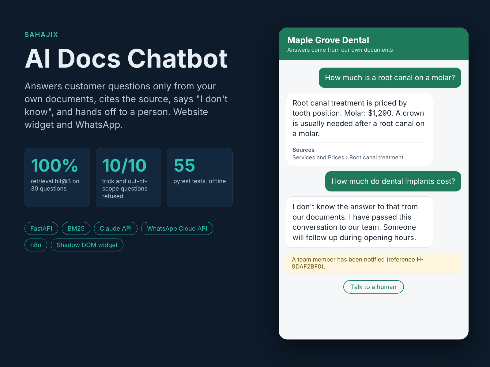
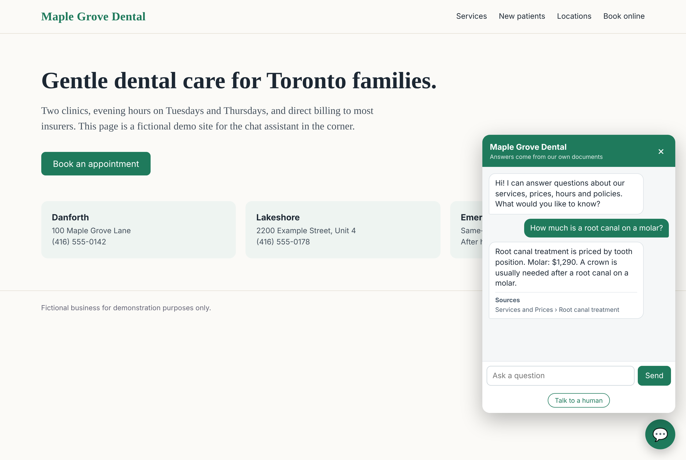
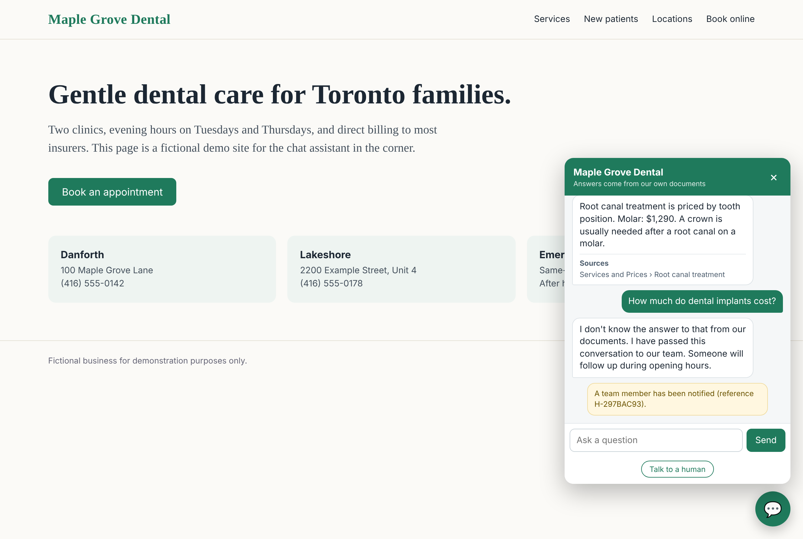
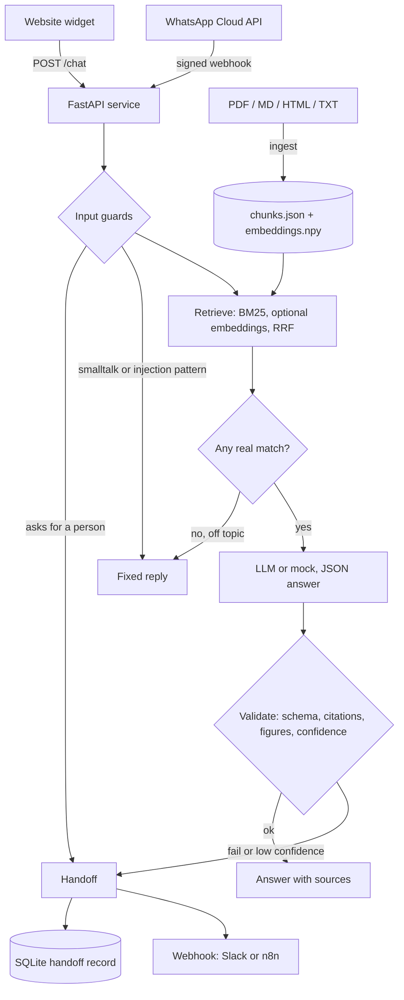

# AI Docs Chatbot

A support assistant that answers only from a business's own documents, shows where each answer came from, says "I don't know" instead of guessing, and passes the conversation to a person when it should. It runs as a website widget and on WhatsApp.



The demo page with the widget open: an answer with its source, then a question the documents cannot answer, which ends in a handoff.





## The problem

Customers ask the same questions every day: what does it cost, are you open Saturday, what is the cancellation fee. Staff answer them by phone, and a generic chatbot is worse than nothing for a clinic or a shop, because one invented price or policy becomes a dispute. This project answers from the documents you already have, and when it cannot, it hands the customer to a human with the transcript attached so nobody has to repeat themselves.

## What it does

- Ingests PDF, Markdown, HTML and plain text, keeps headings with each chunk, and indexes them on disk.
- Retrieves with BM25 by default (no external calls). Embeddings from an OpenAI-compatible or Voyage endpoint can be switched on and are fused with BM25 by reciprocal rank.
- Answers through Claude or any OpenAI-compatible API, or through a built-in deterministic mock so the demo is free. The model must return JSON with `answer`, `citations`, `confidence` and `needs_human`; replies that do not validate are retried.
- Refuses off-topic questions, blocks answers that contain a price or percentage not found in the retrieved text, drops citations that do not point at a retrieved passage, and treats retrieved text as data.
- Creates a handoff record and posts a Slack-compatible webhook with the transcript when the model says so, confidence is low, or the customer asks for a person.
- Keeps a short per-session memory, rate limits per session and per IP, and keeps message content out of logs.
- Ships a one-file embeddable widget (shadow DOM, `textContent` only) and a WhatsApp Cloud API webhook with signature checking.
- Includes an optional n8n workflow that routes handoffs to Slack and logs them to Google Sheets.

## How it works



## Results

All numbers below were measured in this repo with `make eval` and `make test`, using the sample Maple Grove Dental knowledge base (9 documents, 66 chunks) and the mock model. The mock copies sentences from retrieved passages, so these figures say how good retrieval and the guardrails are, not how good a real model's wording is. Nothing here was measured with a paid API: run `make eval` with `ANTHROPIC_API_KEY` set to get those numbers; they are written to `eval/results/`.

| Measure | Result |
| --- | --- |
| Retrieval hit rate @3 (BM25, offline), 30 answerable questions | 100% (30/30) |
| Retrieval hit rate @1 / MRR@3 | 96.7% / 0.983 |
| Answerable questions answered (not refused) | 96.7% (29/30) |
| Citation names the expected document, among answered | 96.6% (28/29) |
| Refusal correct on 10 out-of-scope or trick questions | 100% (10/10) |
| `make eval` run time, 40 questions, mock model | 0.2 s |
| pytest tests / node:test widget tests | 55 / 6, all passing |

Two answerable questions failed with the mock: "How long does insurance pre-approval take?" was refused because the matching passage shares too few of the question's words ("take", "long"), and "What should I bring to my first appointment?" cited the insurance page instead of the new patient page. Both are vocabulary mismatches that plain BM25 cannot bridge; embeddings or a real model are the fix, and I did not measure either here.

Caveats. I wrote the questions and the documents, and set the mock's confidence threshold and the off-topic floor by hand while looking at this set, so treat 100% as optimistic for unseen questions. The 10 trick questions include two prompt-injection attempts; those are caught by a pattern filter before retrieval, which is a first line of defence rather than a proof.

## Run it yourself

```bash
git clone <this repo> && cd ai-docs-chatbot
make setup                 # venv, Python deps, widget test deps
cp .env.example .env       # optional, the demo needs nothing in it
make demo                  # http://localhost:8000/demo
make test-all              # pytest and node:test
make eval                  # retrieval, refusal and citation checks
```

`make demo` builds the index from `data/kb/` and starts the server with the mock model. Open the demo page, click the chat button and try "How much is a root canal on a molar?" and then "How much do dental implants cost?".

With a key, set `ANTHROPIC_API_KEY` (default model `claude-haiku-4-5`) or `OPENAI_API_KEY`, or point `LLM_BASE_URL` and `LLM_MODEL` at any OpenAI-compatible server. Set `EMBEDDINGS_PROVIDER=openai` or `voyage` plus `EMBEDDINGS_API_KEY` for hybrid retrieval, then run `make ingest`.

Embed on a site:

```html
<script src="https://your-host/widget/chat.js" data-api="https://your-host"
        data-title="Your Business" data-accent="#1f7a5c" defer></script>
```

Set `CORS_ORIGINS` to your site origin in production. To add documents, drop files into `data/kb/` and run `make ingest`, or `POST /ingest` with `X-Admin-Token` (enabled only when `ADMIN_TOKEN` is set).

WhatsApp: point the Cloud API webhook at `/whatsapp/webhook`, set `WHATSAPP_VERIFY_TOKEN`, `WHATSAPP_APP_SECRET`, `WHATSAPP_ACCESS_TOKEN` and `WHATSAPP_PHONE_NUMBER_ID`. Replies go to `GRAPH_BASE_URL`, which can point at a fake for testing. Unsigned posts are rejected, and if no app secret is set the endpoint refuses everything.

Screenshots in `assets/` come from `make shots` (needs the demo running and Playwright installed).

### n8n handoff workflow

`workflows/handoff-router.json` takes the handoff webhook, marks urgent conversations (swelling, bleeding, fever and similar words), posts to `#dental-urgent` or `#front-desk` in Slack and appends a row to a Google Sheet. Import it in n8n, create credentials named "Slack account" and "Google Sheets account", set the spreadsheet id and a sheet named Handoffs with the columns Handoff ID, Created, Channel, Reason, Urgent, Session, Last customer message, then set `HANDOFF_WEBHOOK_URL` to the production webhook URL.

What was tested: the file imports cleanly into n8n 2.48.7 with `n8n import:workflow`. I also ran a copy with the Slack and Sheets nodes swapped for HTTP requests to a local fake, activated it, and sent it two handoffs created by this service: the ordinary one went to the front desk branch and the one mentioning swelling and bleeding went to the urgent branch, each followed by the log step. The real Slack and Google Sheets nodes were not executed because they need credentials.

## Project structure

```
docs_chatbot/
  app.py          FastAPI routes: /chat, /ingest, /health, WhatsApp webhook, demo files
  pipeline.py     guard, retrieve, answer, validate, hand off
  ingest.py       PDF/MD/HTML/TXT to heading-aware chunks
  index.py        on-disk index, BM25, coverage score
  retrieval.py    BM25 + optional embeddings, reciprocal rank fusion
  embeddings.py   OpenAI-compatible / Voyage client
  llm.py          Anthropic, OpenAI-compatible and mock clients
  prompt.py       system prompt, passages as data
  guardrails.py   injection patterns, citation and price checks, JSON parsing
  handoff.py      SQLite records, Slack-compatible webhook
  whatsapp.py     signature check, parsing, Graph API replies
  memory.py  ratelimit.py  privacy.py  config.py  schemas.py  cli.py
widget/           chat.js, demo.html, node:test tests
data/kb/          Maple Grove Dental sample documents (fictional)
eval/             40 questions, runner, results/
workflows/        n8n handoff router
tests/            pytest suite
scripts/          sample PDF builder, screenshots, cover
```

## Design decisions

- **BM25 first.** It needs no key, builds in milliseconds and is easy to explain. Embeddings are optional and fused by rank rather than score, because BM25 and cosine scores are not comparable.
- **A coverage score gates everything.** Each passage gets the share of the question's rare-word weight it contains. Words the documents have never seen count at full weight, so a question about implants does not slide through on "dental" and "cost". It sets the off-topic floor and drives the mock's refusals.
- **Validate the model's output, do not trust it.** Citations must match retrieved passages, and any dollar amount or percentage in an answer must appear in the retrieved text. A failed check becomes a refusal and a handoff, not a softer answer.
- **Handoff only when someone could help.** A question the documents cannot answer but that is about the business creates a record. Plainly off-topic questions get a short refusal, so the team's queue is not filled with trivia.
- **Privacy by omission.** Conversation text is held in memory for the session window and never logged; logs carry a hashed session id and the outcome. A transcript is stored only when a handoff is created, and `purge_older_than` deletes old ones.
- **Rate limits are in process.** That is fine for one worker. Behind several, add a limit at the proxy as well.

## Limitations and next steps

- BM25 misses paraphrases. Turn on embeddings, and measure them on your own questions before trusting them.
- The synonym list in `text.py` is hand-made for this domain and the stemmer is crude, so other languages need a different tokenizer.
- The injection filter is a pattern list. The real protection is the prompt structure and output checks, and I have not red-teamed a real model with it.
- The money check covers dollar amounts and percentages, not opening hours or dates.
- Handoff transcripts and WhatsApp numbers go to whatever the webhook points at. Decide who is allowed to see them.
- No admin UI for handoffs, no streaming, one language, and the WhatsApp path has been tested only against fakes, not the live Cloud API.
